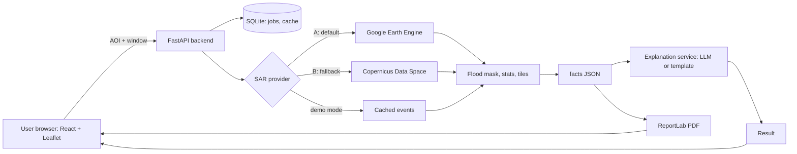

# SAR Translator — Product Requirements Document (PRD)

**Audience:** AI coding agents (primary), the project owner (secondary) **Hackathon:** ASTRA 2026 — Earth Observation & Satellite Applications + Space-Based Disaster Management **Document version:** 1.0 (written 21 Nov 2026) **Tagline:** Turning complex satellite radar data into simple, actionable insights.

> **Note on source material:** the owner's idea brief was cut off at "13. How…". Section 18 lists the assumptions made to fill that gap. The owner should confirm them.

---

## 0. Agent Operating Contract (read this first)

You are an AI coding agent building SAR Translator end to end. Agents will be swapped often because of token limits, so the memory system in Section 15 is **part of the product deliverable**, not an extra.

### 0.1 Non-negotiable rules

1. **First action of the first agent:** run Appendix A (create the memory files). Every later agent starts with Appendix B. If `AGENTS.md` already exists, you are not the first agent. Use Appendix B.
2. **Never fabricate.** Do not invent satellite results, accuracy numbers, test results, dataset names or API behavior. If you cannot verify something, write "UNVERIFIED" next to it and add it to `BUGS.md` or `DECISIONS.md`.
3. **The LLM never computes or invents measurements.** All numbers come from the geospatial pipeline. The LLM only explains them (Section 7).
4. **Do not show an uncalibrated percentage as "confidence".** Use the transparent quality rubric in Section 6.9 unless real calibration exists.
5. **Keep demo mode working at all times.** The app must run from cached sample results even if Earth Engine, the network or the LLM is down (FR-10).
6. **No secrets in the repo or in memory files.** Names of environment variables only.
7. **Preserve working code.** No rewrites or dependency swaps without recording the reason in `DECISIONS.md`. Major architecture changes need owner approval.
8. **Update memory files after every meaningful task** (Section 15). Do not wait to be reminded.

### 0.2 Human-in-the-loop protocol (what the owner must do)

Some steps only the owner can do: creating accounts, granting access, supplying keys, recording a video, submitting the project. When you hit one:

1. **Do not block.** Switch to work that does not depend on the owner (mock/fixture mode, tests, UI, docs).
2. **Write the item to `docs/agent-memory/USER_ACTIONS.md`** with status `OPEN`.
3. **Tell the owner in chat**, using this exact format:

```
OWNER ACTION NEEDED  [UA-007]  Priority: BLOCKING | SOON | LATER
What:           <one sentence>
Why needed:     <one sentence>
Steps:          1) … 2) … 3) …   (click-level detail, with URLs)
How I will verify: <command or check the agent will run>
Send back:      <exactly what to paste in chat; NEVER paste secrets into chat, put them in the .env file instead>
Until then I will: <what the agent continues doing>
```

4. When the owner confirms, run the verification, mark the item `DONE` and note the date.

The pre-planned owner tasks are listed in Section 14. Add more as they come up.

### 0.3 Definition of Done for the project

- Every P0 requirement in Section 5 passes its acceptance criteria and is marked **verified** in `PROGRESS.md` with how it was tested.
- The app runs end to end for at least 3 real, cached historical flood events and for one live analysis (if Earth Engine access is working).
- A validation table with real measured metrics is in the README (Section 12).
- Demo video script, pitch outline and submission checklist (Section 17) are complete.
- All memory files are accurate and `HANDOFF.md` is current.

---

## 1. Product Summary

SAR Translator lets a non-expert select an area on a map, compare Sentinel-1 radar observations from two time periods, see where surface water has likely expanded, and read a plain-language explanation (English or Hindi). The user can then download a one-page evidence report with dates, maps, area estimates, method, and limitations.

**Core value:** satellite data → AI-assisted analysis → a report someone can act on.

**What it is not:** it does not replace field assessment, make claim decisions, or claim damage to crops or buildings. It estimates **detected surface-water change** and says so.

### 1.1 Problem

- Optical satellites cannot see through monsoon clouds. SAR can.
- SAR imagery is hard for non-specialists to read.
- Decision makers (district officers, insurers, agri-businesses) need answers such as "which areas likely flooded, when, how much, and how reliable is that?", not rasters.

### 1.2 Primary persona for the pitch

**Flood-claim analyst at an insurer** (first commercial wedge). Secondary: district disaster-management officer, agri-business risk analyst, a farmer or journalist who needs a quick, plain answer.

---

## 2. Research Findings and Constraints the Agent Must Respect

### 2.1 Facts verified during PRD research (Nov 2026)

| # | Finding | Implication for the build |
| --- | --- | --- |
| R1 | **Sentinel-1 constellation changed in 2026.** Sentinel-1D was launched 4 Nov 2025 and its calibrated data has been available since 17 Apr 2026. Sentinel-1C and 1D re-established a 6-day nominal repeat cycle on 24 Jun 2026. Sentinel-1A ended operations on 29 Jun 2026. Sentinel-1B failed in Dec 2021. The new C/D plan is shifted by 1 day compared with the old A/B plan (sources: Copernicus Data Space Ecosystem notices, ESA, ASF DAAC). | Coverage depends on the date. Before the Dec 2021 failure there were two satellites (A and B). From Dec 2021 to about Mar 2025 there was effectively one (A). Do not promise a fixed revisit. **Always display the real acquisition dates.** Choose demo events knowing which satellites existed then. |
| R2 | **Earth Engine licensing.** Free use is for verified *noncommercial* projects. Noncommercial quota tiers took effect on 27 Apr 2026, and projects default to the Community Tier (150 EECU-hours). Earth Engine's additional API terms limit the API to development, research or educational use and bar sustained commercial use. Commercial use requires a paid commercial project (sources: Google Earth Engine documentation). | Earth Engine is fine for a hackathon prototype. It is **not** a free long-term backend for an insurer-facing paid product. Build a **provider abstraction** (Section 8.3) and state this honestly in the business section. |
| R3 | Radar returns depend on orbit geometry, so changes between incompatible acquisitions are partly false. | Pair only scenes with the same orbit direction (ascending or descending), same relative orbit, same mode and polarization (Section 6.2). |
| R4 | Dark radar pixels are not always water. Examples: radar shadow, smooth surfaces such as tarmac or dry sand, and flooded vegetation or buildings, which may brighten. | Apply terrain masks, pre-existing water exclusion and minimum-size filtering. Report limitations. |

### 2.2 Items the agent MUST verify before relying on them

Record each result in `DECISIONS.md`. These are from the PRD author's knowledge and were not all re-checked:

| ID | Item to verify | How |
| --- | --- | --- |
| V1 | Whether Earth Engine's `COPERNICUS/S1_GRD` collection currently includes Sentinel-1C/1D scenes, and the latest available date | Query the collection for the newest `system:time_start` and the `platform_number` property |
| V2 | Exact band and property names: `VV`, `VH`, `instrumentMode`, `orbitProperties_pass`, `relativeOrbitNumber_start`, `transmitterReceiverPolarisation` | Print one image's properties |
| V3 | Catalog IDs: `JRC/GSW1_4/GlobalSurfaceWater`, `COPERNICUS/DEM/GLO30`, `ESA/WorldCover/v200`, a HAND dataset (e.g. `MERIT/Hydro/v1_0_1`) | Fetch each in a script and check bands |
| V4 | Whether the owner's Cloud project is registered for noncommercial use and which quota tier applies | Owner action UA-002 |
| V5 | ASTRA 2026 submission rules: required deliverables, team size, judging weights, deadline, whether non-Indian data is penalized | Owner action UA-001 |
| V6 | Availability of Indian SAR sources for stretch goals: NISAR (NASA–ISRO mission, launched 2025), ISRO Bhuvan and NRSC data | Search official portals; record license and access path. Use only if cleanly accessible |
| V7 | Copernicus Data Space (CDSE) free-tier limits for the fallback provider (openEO, Sentinel Hub APIs, STAC) | Read current CDSE docs before implementing Provider B |
| V8 | Existing competitors (e.g. Copernicus Emergency Management Service's global flood monitoring, UN-SPIDER recommended practices, commercial flood-analytics firms) and what they already offer | Short web scan; update Section 9 of the pitch |

### 2.3 Dataset plan

| Purpose | Dataset | Notes |
| --- | --- | --- |
| Main input | Sentinel-1 GRD (IW, VV/VH) | Via Earth Engine (Provider A) or CDSE (Provider B) |
| Pre-existing water mask | JRC Global Surface Water | Occurrence/seasonality |
| Terrain mask | Copernicus GLO-30 DEM, slope | Remove steep areas and radar-shadow-prone terrain |
| Flood-prone-terrain mask | HAND (Height Above Nearest Drainage) | Exclude high ground that cannot flood |
| Land cover exposure (P1) | ESA WorldCover v200 | Cropland and built-up area inside the flood footprint |
| Visual context (optional) | Sentinel-2 | Only when cloud-free; strictly optional |
| Validation | Sen1Floods11 and agency flood maps for specific events | Used only to measure real accuracy |
| Stretch (India theme) | NISAR, Bhuvan/NRSC products | Only if V6 passes |

**Attribution:** include "Contains modified Copernicus Sentinel data \[year\]" and each dataset's required credit in the UI footer and PDF.

---

## 3. Goals, Non-Goals, Success Metrics

### 3.1 Goals

- G1: A working, reliable end-to-end flow: area → analysis → map → explanation → PDF.
- G2: Scientifically honest outputs: dates, method, thresholds, limitations and a transparent quality rubric.
- G3: Real measured accuracy against reference data on at least 3 events.
- G4: Strong hackathon story: Indian monsoon flooding, clear commercial wedge, working demo.

### 3.2 Non-goals (MVP)

- No claim approval, damage valuation or crop-loss estimate.
- No user accounts, payments or multi-tenant features.
- No real-time alerts, no multi-class land change, no building-level analysis.
- No custom SAR preprocessing from raw SLC data.

### 3.3 Success metrics

| Metric | Target |
| --- | --- |
| Analysis time for an AOI of ≤ 25 km² | Under 60 s typical; progress shown if longer |
| Demo reliability | 100% of cached demo events load offline |
| Measured accuracy | Report precision, recall, F1/IoU on ≥ 3 events; no target is promised in advance, only honest reporting |
| Explanation faithfulness | 0 numbers in LLM text that are absent from the computed facts (automated check) |
| Non-expert test | At least 3 non-expert people can say, without help, what the result means |

---

## 4. Users and Core Scenarios

| Persona | Question | What they get |
| --- | --- | --- |
| Insurance claims analyst | "Was this insured region inundated around 14 July?" | Dated before/after maps, flooded area, quality rating, PDF for the claim file |
| District officer | "Which blocks need field visits first?" | Flood footprint with area stats and cropland/built-up exposure (P1) |
| Agri-business analyst | "Did water spread into our fields?" | Flood overlay on field polygons (uploaded GeoJSON, P1) |
| Citizen or journalist | "Has my village flooded?" | Plain-language answer in Hindi or English |

### Key user stories

- **US-1** As a user, I search for a place and draw a boundary so that I define my area of interest.
- **US-2** As a user, I choose an analysis window (7, 30 or 90 days, or a custom event date) so that I compare the right periods.
- **US-3** As a user, I see which satellite dates were used and why, so that I can trust or challenge the result.
- **US-4** As a user, I swipe or toggle between before, after and detected change on the map.
- **US-5** As a user, I read a short explanation in my language that never overstates certainty.
- **US-6** As a user, I download a one-page PDF report with evidence and limitations.
- **US-7** If no valid image pair exists, I get a clear message and suggestions, not a guess.

---

## 5. Functional Requirements

Priority: **P0** = must ship, **P1** = should ship, **P2** = nice to have.

| ID | Pri | Requirement | Acceptance criteria |
| --- | --- | --- | --- |
| FR-1 | P0 | **Area selection.** Place search (Nominatim via backend proxy), draw polygon or rectangle, show area in km², validate geometry | Self-intersecting or oversized shapes are rejected with a clear message; max area configurable (default 100 km²); area shown matches an equal-area calculation within 1% |
| FR-1b | P1 | Upload GeoJSON/KML as AOI | Valid file draws on the map; invalid file gives a readable error |
| FR-2 | P0 | **Time window.** Presets 7/30/90 days ending at the latest usable observation, plus a custom event date or date range | The dates used are shown before and after processing |
| FR-3 | P0 | **Scene selection and comparability.** Choose a pre-period and post-period set with matching orbit direction, relative orbit, instrument mode and polarization | Pairing rules are applied (Section 6.2); rejected options and reasons are available in the API response; no valid pair → explicit "no comparable pair" result |
| FR-4 | P0 | **Flood-change detection** per Section 6 | Output includes the flood mask, area statistics, parameters used, and masks applied |
| FR-5 | P0 | **Results map.** Before, after and change layers, legend, opacity control | Layers align with the AOI; toggling does not reload the page. P1: swipe comparison |
| FR-6 | P0 | **Statistics panel.** AOI area, possible-flood area (ha and km²), % of AOI, excluded pre-existing water area, valid-data coverage, acquisition dates, platform(s) | All values come from the backend result JSON; none are hard-coded |
| FR-7 | P1 | **Exposure.** Cropland and built-up area inside the flood footprint (WorldCover) | Labeled "land-cover class within detected flood area", not "damage" |
| FR-8 | P0 | **AI explanation** in English and Hindi, grounded in computed facts (Section 7) | Numeric guard passes; includes dates, caveats and a "verify before decisions" statement; template fallback works without the LLM |
| FR-9 | P0 | **PDF evidence report** (Section 11) | One page for the standard report; contains maps, stats, dates, method, limitations, attributions |
| FR-10 | P0 | **Demo/cached mode.** At least 3 precomputed real events stored as JSON + images | Works with no network; clearly labeled "cached example" |
| FR-11 | P0 | **Async job handling.** Submit → job id → poll status → result | Progress states shown; timeout and error states show a friendly message; no UI freeze |
| FR-12 | P0 | **Quality indicator** via the rubric in Section 6.9 | Rubric inputs are visible; no unexplained percentage |
| FR-13 | P1 | **Result caching** keyed by AOI hash + parameters | Repeat request returns in under 3 s |
| FR-14 | P1 | Download flood polygons as GeoJSON | File opens in QGIS/geojson.io |
| FR-15 | P2 | Analysis history (SQLite) | List and reopen previous analyses |
| FR-16 | P2 | Natural-language question box ("Has my village flooded in the last 30 days?") that maps to AOI + window | Falls back to manual selection when the place or date is ambiguous |
| FR-17 | P1 | Validation page or README section with measured metrics (Section 12) | Numbers are reproducible from a script in `validation/` |
| FR-18 | P2 | Indian-data enrichment (NISAR/Bhuvan) if V6 passes | Clearly labeled as supplementary |

---

## 6. Scientific Method Specification (the core of the product)

All thresholds below are **starting defaults to be tuned and validated**, not universal truths. Record the final values in `DECISIONS.md` and in every report.

### 6.1 Input collection

Sentinel-1 GRD, mode IW, polarizations VV (primary) and VH (secondary), filtered to the AOI bounds. Verify property names first (V2).

### 6.2 Pair compatibility

Pick the combination of (orbit direction, relative orbit) that **fully covers the AOI** (or covers the most of it) in **both** periods. Never mix ascending and descending scenes, and never mix relative orbits. Prefer the same platform where possible. If coverage is below 95% of the AOI, flag it in quality scoring. If no combination exists in both periods, return `NO_COMPARABLE_PAIR` with the reasons.

### 6.3 Composite construction

- **Pre-event baseline:** median of the scenes in the pre-period (the most recent window before the post-period, default 30 days earlier, up to N scenes).
- **Post-event image:** median of scenes in the post-period window (default 12 days) or, in "single scene" mode, the scene closest to the event date. Document the trade-off: medians reduce speckle but can hide short-lived floods.
- Averaging must be done in **linear power**, then converted back to dB. Medians can be taken in dB.

### 6.4 Speckle reduction

Apply a focal median (radius about 30–50 m) to each composite, or an equivalent filter. Record the choice.

### 6.5 Detection rule (default)

For each pixel:

- `diff_dB = post_VV_dB − pre_VV_dB`
- candidate flood = `post_VV_dB < T_water` **and** `diff_dB < T_change`
- defaults: `T_water = −15 dB`, `T_change = −3 dB` (VH, if used as a second check, needs a lower `T_water`)
- optional adaptive mode: derive `T_water` by Otsu thresholding of the post image over the AOI when its histogram is clearly bimodal; otherwise use the default
- optional P2 "possible flooded vegetation" class: a strong increase in backscatter (`diff_dB > +3 dB`) in vegetated land cover next to detected water, labeled **low confidence**

### 6.6 Masks applied after detection

1. **Pre-existing water:** pixels already below `T_water` in the pre image, plus JRC permanent water (high occurrence). Report their area separately as "pre-existing water".
2. **Terrain:** exclude slope above about 5° and (if HAND is available) HAND above about 15 m.
3. **Connectivity filter:** remove clusters smaller than about 8 pixels.
4. Record each mask and its excluded area in the result JSON.

### 6.7 Area calculation

Use the geospatial engine's true per-pixel area (e.g. `ee.Image.pixelArea()`), not a fixed pixel size. Sum within the AOI at the processing scale (10 m by default; coarser only for large AOIs and recorded in the result). Report both hectares and km². State: "area of detected surface-water change", not "damaged area".

### 6.8 Vector output

Vectorize the final mask to simplified GeoJSON polygons for the map and download. Cap feature count and file size.

### 6.9 Quality rubric (replaces a fake percentage)

Score each item and show the table in the UI and report:

| Factor | Good | Fair | Poor |
| --- | --- | --- | --- |
| Pair compatibility | Same orbit, same platform | Same orbit, different platform | Not allowed (no result) |
| Time gap between periods and event | ≤ 12 days | 13–24 days | > 24 days |
| AOI coverage by both composites | ≥ 95% | 80–95% | < 80% |
| Scenes per composite | ≥ 3 | 2 | 1 |
| Share of AOI masked by terrain | < 10% | 10–30% | > 30% |

Overall: **High** if no Poor and ≤ 1 Fair; **Low** if any Poor; otherwise **Medium**. These cut-offs are placeholders to refine after validation (Section 12). If real calibration data is later produced, a calibrated probability may replace this, with the method documented.

### 6.10 Known failure modes to surface in the UI/report

Radar shadow and layover in hilly areas; wind-roughened water appearing bright; flooded vegetation and urban areas under-detected; dry sand or smooth pavement looking like water; frozen or wet-snow ground (rare in monsoon India); acquisition time not equal to flood peak; Sentinel-1 gaps.

---

## 7. AI Specification

### 7.1 Where AI is used (be honest in the pitch)

| Module | MVP implementation | Later |
| --- | --- | --- |
| Change detection | Classical thresholding with masks (Section 6) | Model trained on labeled flood data |
| Change classification | Rules: "possible flooding" vs "no significant flooding detected" vs "insufficient data" | scikit-learn or small CNN on VV, VH, diff, HAND, slope; trained on Sen1Floods11 (P2) |
| Natural-language explanation | LLM, grounded on computed facts | Multilingual expansion |

### 7.2 Grounded explanation contract

The backend builds a `facts` JSON from the real result (area, dates, platform, orbit, quality rubric, exposure, masks, thresholds, warnings). The LLM receives **only** this JSON and returns strict JSON:

```json
{
  "language": "en|hi",
  "headline": "…",
  "summary": "2–4 sentences",
  "key_findings": ["…"],
  "limitations": ["…"],
  "suggested_next_steps": ["…"]
}
```

**Rules for the prompt:**

- Use only numbers present in `facts`. Do not extrapolate, estimate damage, name causes, or give insurance or legal verdicts.
- Use hedged wording ("suggests", "consistent with").
- Always include the observation dates and a "verify before emergency or insurance decisions" statement.
- Simple language, short sentences, no jargon such as "backscatter" unless explained.

### 7.3 Safeguards (implement and test)

1. **Numeric guard:** extract every number from the LLM text and confirm it appears in `facts` (allowing for unit conversion and rounding). On failure, regenerate once, then fall back to the template.
2. **Template fallback:** deterministic English and Hindi templates that need no LLM.
3. **Provider configurable by env var** (`LLM_PROVIDER`, `LLM_MODEL`, `LLM_API_KEY`). Do not hard-code a model name in code paths; read it from config.
4. **Hindi review:** the owner or a native speaker should review Hindi output (UA-009).
5. Set low temperature, cap tokens and log prompt version.

---

## 8. Architecture and Tech Stack

### 8.1 Stack

| Layer | Choice | Notes |
| --- | --- | --- |
| Frontend | React + Vite + TypeScript + Tailwind CSS | Single-page app |
| Map | Leaflet + react-leaflet + a drawing plugin (leaflet-geoman or leaflet-draw) | Check which plugin is maintained and works with the chosen React version; record in `DECISIONS.md` |
| Charts | Recharts | Small stats visuals only |
| Backend | Python 3.11+ + FastAPI + Pydantic | Async jobs via `BackgroundTasks` or a simple in-process queue; no Celery for MVP |
| Geo libs | `earthengine-api`, `shapely`, `pyproj`, `geojson` | `rasterio`/`numpy` only if Provider B needs local processing |
| ML (P2) | scikit-learn | Only after the rule-based pipeline is validated |
| LLM | Provider-agnostic wrapper | Config via env vars; template fallback |
| PDF | ReportLab | One-page report |
| Storage | SQLite (SQLAlchemy) + files under `data/` | Results cache, job table, cached demo events |
| Testing | pytest, Vitest/React Testing Library, optional Playwright for one e2e | Tests must be real; never mark untested features verified |
| Hosting | Frontend on Vercel or Netlify; backend on Render, Railway or Fly.io | Owner actions UA-005, UA-006 |

### 8.2 High-level data flow

1. Browser sends an `AnalysisRequest` (AOI GeoJSON, window, options) to `POST /api/analyses`.
2. Backend validates the AOI and creates a job record, returns `job_id`.
3. Worker calls the **SAR provider** to find scenes, select a compatible pair, compute the flood mask and statistics, and render map tiles/thumbnails.
4. Worker builds the `facts` JSON, calls the explanation service (LLM or template), and stores the result.
5. Frontend polls `GET /api/analyses/{id}`, then renders map layers, stats, explanation and the PDF download.

The diagram below shows how the pieces connect.



### 8.3 Provider abstraction (important)

Define one interface and implement it for each data source:

```python
class SarProvider(Protocol):
    def list_scenes(self, aoi, start, end) -> list[SceneMeta]: ...
    def analyze(self, aoi, pre_scenes, post_scenes, params) -> AnalysisResult: ...
    def render_layers(self, result) -> LayerSet: ...   # tile URLs and/or PNG thumbnails
```

- **Provider A (default): Earth Engine.** Fastest route. Authenticate with a service account (owner action UA-003). Tile URLs from Earth Engine expire, so the frontend must request fresh ones or the backend must store static images for reports.
- **Provider B (fallback, P2): Copernicus Data Space Ecosystem.** Search via the STAC/OData catalogue and process with openEO or Sentinel Hub APIs. Check V7 first. This is the route that avoids Earth Engine commercial licensing.
- **Provider C: `CachedProvider`** serves stored real events and is used for demo mode and for tests.

### 8.4 Suggested repository layout

```
sar-translator/
├─ AGENTS.md
├─ README.md
├─ .env.example                 # variable NAMES only, no values
├─ docs/
│  ├─ PRD.md                    # copy of this PRD
│  └─ agent-memory/
│     ├─ PROJECT_CONTEXT.md
│     ├─ PROGRESS.md
│     ├─ ARCHITECTURE.md
│     ├─ DECISIONS.md
│     ├─ BUGS.md
│     ├─ HANDOFF.md
│     └─ USER_ACTIONS.md
├─ backend/
│  ├─ app/
│  │  ├─ main.py
│  │  ├─ config.py
│  │  ├─ api/                   # routers: analyses, geocode, demo, reports
│  │  ├─ providers/             # base.py, earth_engine.py, cdse.py, cached.py
│  │  ├─ pipeline/              # pairing.py, detect.py, masks.py, stats.py, quality.py
│  │  ├─ ai/                    # facts.py, explain.py, guard.py, templates_en.py, templates_hi.py
│  │  ├─ reports/               # pdf.py, assets
│  │  ├─ db/                    # models.py, session.py
│  │  └─ schemas/               # Pydantic models
│  ├─ tests/
│  └─ pyproject.toml / requirements.txt
├─ frontend/
│  ├─ src/
│  │  ├─ components/            # MapView, AoiTools, ResultPanel, QualityTable, LanguageToggle…
│  │  ├─ pages/
│  │  ├─ api/                   # typed client
│  │  └─ i18n/                  # en.json, hi.json for UI text
│  └─ package.json
├─ data/
│  └─ demo_events/               # cached real results: JSON + PNG + GeoJSON
├─ validation/                   # scripts + results table for Section 12
└─ scripts/                      # dev helpers (run, seed demo data, check access)
```

The agent may adjust this layout, but must record the final structure in `ARCHITECTURE.md`.

---

## 9. API and Data Contracts

### 9.1 Endpoints (MVP)

| Method | Path | Purpose |
| --- | --- | --- |
| GET | `/api/health` | Liveness, provider status (EE reachable, LLM configured) |
| GET | `/api/geocode?q=` | Proxy to Nominatim with a proper User-Agent and rate limit |
| POST | `/api/analyses` | Create an analysis job; returns `job_id` |
| GET | `/api/analyses/{id}` | Status and, when done, the result |
| GET | `/api/analyses/{id}/layers` | Fresh map layer URLs (tile URLs or image URLs and bounds) |
| GET | `/api/analyses/{id}/geojson` | Flood polygons |
| POST | `/api/analyses/{id}/explain?lang=en\|hi` | (Re)generate the explanation |
| GET | `/api/analyses/{id}/report.pdf?lang=` | One-page PDF |
| GET | `/api/demo/events` | List cached demo events |
| GET | `/api/demo/events/{slug}` | Cached result for one event |

### 9.2 Result JSON (shape guide)

```json
{
  "id": "...",
  "status": "done|running|failed|no_comparable_pair",
  "aoi": {"geojson": {}, "area_km2": 5.0},
  "periods": {"pre": ["YYYY-MM-DD"], "post": ["YYYY-MM-DD"]},
  "scenes": {"platforms": ["S1C"], "orbit_pass": "ASCENDING", "relative_orbit": 0, "pre_count": 0, "post_count": 0},
  "params": {"T_water_db": -15, "T_change_db": -3, "speckle_radius_m": 40, "scale_m": 10},
  "stats": {"flood_ha": 0, "flood_km2": 0, "flood_pct_of_aoi": 0, "preexisting_water_ha": 0, "valid_coverage_pct": 0, "masked_terrain_pct": 0},
  "exposure": {"cropland_ha": null, "built_up_ha": null},
  "quality": {"overall": "High|Medium|Low", "factors": []},
  "warnings": [],
  "explanation": {"en": {}, "hi": {}},
  "created_at": "...",
  "provider": "earth_engine|cdse|cached",
  "software_version": "git sha"
}
```

Values above are placeholders showing structure only. Every real value must come from computation.

### 9.3 Database (SQLite)

- `analyses(id, created_at, status, aoi_hash, params_json, result_json, provider, error)`
- `explanations(id, analysis_id, lang, prompt_version, text_json, source[llm|template])`
- `demo_events(slug, title, description, result_path)`
- Cache key = SHA-256 of normalized AOI + dates + params + software version.

---

## 10. Non-Functional Requirements

| Area | Requirement |
| --- | --- |
| Performance | Limit AOI size (default 100 km², configurable); reduce scale only when needed and record it; cache results; request timeout with friendly message |
| Reliability | Demo mode must work offline; clear errors when Earth Engine auth or quota fails; retries with backoff on transient errors |
| Security | Secrets only in environment variables; CORS restricted to the frontend origin; validate and size-limit uploads; rate-limit the public endpoints; never log keys |
| Privacy | AOIs may be sensitive (insured locations). Do not send coordinates to the LLM unless needed; the `facts` JSON can carry a place name and rounded centroid instead of exact boundaries |
| Licensing | Attribution for Copernicus, JRC, ESA WorldCover, OpenStreetMap and any basemap. Follow Nominatim's usage policy (identify the app, max 1 request per second, cache). Respect basemap tile terms; use a provider whose terms permit the use |
| Accessibility and UX | Colour-blind-safe palette for flood overlay; keyboard-usable controls; mobile-responsive (judges may open it on a phone) |
| i18n | UI strings in `en.json` and `hi.json`; explanations in English and Hindi |
| Observability | Structured logs with job id; a `/api/health` page |
| Reproducibility | Every result stores parameters, scene IDs and software version |

---

## 11. PDF Evidence Report Specification

One A4 page for the standard report (a second optional "methods" page is allowed). Contents:

1. Title, analysis ID, generated date and time, language.
2. AOI name or centroid (rounded), AOI area.
3. Observation table: pre and post dates, satellite(s), orbit direction and relative orbit, polarization.
4. Before / after / detected-change maps with scale and north arrow, each labeled with its date. Use static images produced by the provider (no dependence on live tile servers).
5. Key numbers: possible flood area (ha and km²), % of AOI, pre-existing water excluded, valid coverage.
6. Quality rubric table (Section 6.9) and the overall rating.
7. Plain-language explanation (selected language).
8. Method summary (3–5 lines) with thresholds used.
9. Limitations and "verify before emergency or insurance decisions" statement.
10. Attributions and a note: "This is an automated screening estimate, not a field-verified damage assessment."

Hindi PDFs need a Devanagari-capable font (e.g. a Noto Sans Devanagari file bundled in the repo with its license). Test rendering visually.

---

## 12. Validation and Testing Plan

### 12.1 Scientific validation (do this; it is the credibility of the project)

- **Dataset:** Sen1Floods11 (hand-labeled flood events with Sentinel-1 imagery) and, where obtainable, official flood-extent maps for Indian events (Copernicus EMS, government or research releases). Confirm access and license first (owner action UA-008 if downloads need accounts).
- **Metrics:** precision, recall, F1 and IoU for the flood class, computed per event and overall.
- **Procedure:** keep a separate tuning set and test set; tune `T_water`, `T_change`, and mask thresholds on the tuning set only; report the final numbers on the test set.
- **Output:** `validation/results.md` plus a README table. Include the events, dates and how reference data was obtained. If results are weak for an event type (e.g. urban flooding), say so.
- **Rubric calibration:** check whether High/Medium/Low actually correlate with higher accuracy. Adjust cut-offs and document.

### 12.2 Software tests

| Level | What to test |
| --- | --- |
| Unit | AOI validation, area calculation, pairing logic (using fixture scene metadata), quality rubric, numeric guard, template rendering, report builder |
| Integration | API flow with `CachedProvider`; Earth Engine provider smoke test run only when credentials exist (skipped otherwise, and marked as skipped, not passed) |
| End to end | One Playwright (or manual scripted) run: pick demo event → see map → read explanation → download PDF |
| LLM faithfulness | 20 fixed `facts` cases → explanation passes numeric guard; adversarial cases (missing data, zero flood, no pair) produce correct wording |
| Visual | Manually open the PDF in English and Hindi; check fonts, map alignment and legends |

### 12.3 Demo event selection

Pick **3 or more** real events and cache them. Criteria: heavy cloud during the event, clear radar coverage, a reference map available, at least one in India (monsoon or cyclone flooding), and at least one with a negative or hard case (to show honest limitations). Use the actual Sentinel-1 availability for those dates (R1): e.g. events before Dec 2021 had two satellites; events from 2022 to early 2025 mostly had one. Record why each event was chosen in `DECISIONS.md`.

---

## 13. Roadmap and Task Breakdown

Work in phases. Do not start a phase until the previous phase's exit criteria are met, except where noted. After each phase, update the memory files.

### Phase 0 — Project memory and scaffolding (first agent only)

- Run Appendix A and create all memory files plus `README.md`, `.env.example`, repo structure, and a copy of this PRD at `docs/PRD.md`.
- Open owner actions UA-001 to UA-004.
- **Exit:** all memory files exist and describe the real (initial) state; app skeleton runs (`/api/health` returns OK; frontend shows a map).

### Phase 1 — Access and data reality check

- Complete V1–V3 with real queries (once UA-002/003 are done). Write `scripts/check_access.py`.
- Fetch one real Sentinel-1 pair for a known flooded area. Save scene metadata.
- If Earth Engine access is delayed, build the `CachedProvider` and the full UI against fixtures in parallel.
- **Exit:** a script prints available scenes and orbit info for a test AOI, or the blocker is documented in `USER_ACTIONS.md`.

### Phase 2 — Core analysis pipeline (backend)

- Implement `pairing.py`, `detect.py`, `masks.py`, `stats.py`, `quality.py` with unit tests.
- Implement the Earth Engine provider and result JSON.
- Produce results for the first demo AOI and check them by eye against a known flood map.
- **Exit:** `POST /api/analyses` returns a correct result for a test AOI; pairing rejects incompatible scenes in tests.

### Phase 3 — Frontend MVP

- Map with place search and polygon drawing, window selector, progress UI, results map layers, stats, quality table, error states.
- Demo-events picker.
- **Exit:** a user can complete the flow without reading docs; layout works on a phone.

### Phase 4 — AI explanation and report

- Facts builder, LLM wrapper, numeric guard, templates (English and Hindi), PDF generation.
- **Exit:** FR-8 and FR-9 acceptance criteria pass; Hindi PDF renders correctly.

### Phase 5 — Validation and hardening

- Run the validation procedure, tune thresholds on the tuning set, fill the README table, calibrate the rubric.
- Add caching, rate limits, retries, and logging. Cache 3+ demo events.
- **Exit:** Definition of Done items for science and reliability are met.

### Phase 6 — Deploy and polish

- Deploy frontend and backend (owner actions), set environment variables on the hosts, test the live URL from a different device.
- Fix UX issues from a 3-person usability test.
- **Exit:** public URL works; demo mode works if live analysis fails.

### Phase 7 — Submission package

- Demo video script and recording checklist, pitch outline, README polish, submission checklist (Section 17).
- **Exit:** owner has everything needed to submit.

### Stretch backlog (only after Phase 6 is done)

FR-1b, FR-7 (exposure), FR-13 to FR-16, Provider B, ML classifier trained on Sen1Floods11, NISAR/Bhuvan enrichment, roads/buildings exposure using OpenStreetMap.

---

## 14. Owner Action Plan (what the project owner must do)

The agent records these in `docs/agent-memory/USER_ACTIONS.md` and raises each one **at the moment it is needed**, using the format in Section 0.2. Screens on Google, GitHub or hosting sites change over time. If a screen differs from the steps, tell the agent what you see and it will adapt.

| ID | When | Priority | Summary |
| --- | --- | --- | --- |
| UA-001 | Phase 0 | BLOCKING for planning | Share ASTRA 2026 rules and deadline |
| UA-007 | Phase 0 | BLOCKING | Install Python, Node.js and Git |
| UA-005 | Phase 0 | SOON | Create the GitHub repository |
| UA-002 | Phase 1 | BLOCKING for live data | Register Google Earth Engine (noncommercial) |
| UA-003 | Phase 1 | BLOCKING for live data | Create a service account and key |
| UA-004 | Phase 4 | SOON | Get an LLM API key |
| UA-008 | Phase 5 | SOON | Allow validation dataset downloads |
| UA-009 | Phase 4 | SOON | Review the Hindi text |
| UA-006 | Phase 6 | SOON | Create hosting accounts and set environment variables |
| UA-010 | Phase 6 | SOON | Run a 3-person usability test |
| UA-013 | Phase 5–7 | LATER | Talk to 2–3 potential customers |
| UA-011 | Phase 7 | LATER | Record the demo video |
| UA-012 | Phase 7 | LATER | Submit the project |
| UA-014 | Stretch | LATER | Register for Indian data portals (if V6 passes) |

### UA-001 — Share the ASTRA 2026 rules

1. Open the hackathon page or rulebook.
2. Copy the text (or send the link) covering: deadline, required deliverables (code, video, deck, live link?), team size, judging criteria and weights, any rule about satellite data sources.
3. Paste it in chat. *Why:* the agent will align the demo, README and pitch to the real criteria.

### UA-007 — Install local tools

1. Install **Python 3.11 or newer** from python.org (tick "Add to PATH" on Windows).
2. Install **Node.js 20 LTS or newer** from nodejs.org.
3. Install **Git** from git-scm.com.
4. Open a terminal and run `python --version`, `node --version`, `git --version`. Paste the three outputs in chat.

### UA-005 — Create the GitHub repository

1. Sign in at github.com and click **New repository**.
2. Name it `sar-translator`. Choose Private for now. Do **not** add a README (the agent creates it).
3. Copy the repository URL and paste it in chat. If the agent works in your local folder, it will give you the exact `git remote add` and `git push` commands to run.

### UA-002 — Register Google Earth Engine (noncommercial)

1. Sign in with a Google account you control (use a personal or institutional account that you can keep during and after the hackathon).
2. Go to the Earth Engine sign-up page (earthengine.google.com) and choose the **noncommercial / unpaid** option. Answer the questions truthfully. This is a hackathon prototype, which is generally in scope for development and research, but commercial use later needs a commercial project.
3. Create a new Google Cloud project when asked, for example `sar-translator-demo`, and complete the registration.
4. Confirm in the Cloud Console that Earth Engine is enabled for that project. Paste the **project ID** (not secrets) in chat.
5. Tell the agent which quota tier the project shows, if the page displays one.

### UA-003 — Create a service account for the backend

1. In Google Cloud Console, select your project, then **IAM & Admin → Service Accounts → Create service account**. Name it `sar-translator-backend`.
2. Grant it the roles the agent specifies at that time (the agent will check current Earth Engine documentation first and tell you the exact role names).
3. Open the service account → **Keys → Add key → Create new key → JSON**. A file downloads.
4. Move the file to `backend/secrets/` in the project (this folder is git-ignored). **Never paste its contents in chat and never commit it.**
5. Make sure the service account is registered for Earth Engine use if the console asks.
6. Tell the agent the file name. The agent sets `GOOGLE_APPLICATION_CREDENTIALS` and runs `scripts/check_access.py`.

For quick local development the agent may instead ask you to run `earthengine authenticate` once, then use your user credentials locally.

### UA-004 — Get an LLM API key

1. Choose a provider you have access to (the agent will recommend one based on cost and Hindi quality).
2. Open that provider's console, create an API key, and set a spending limit if offered.
3. Copy `.env.example` to `.env` in `backend/`, then paste the key as the value of `LLM_API_KEY`. Set `LLM_PROVIDER` and `LLM_MODEL` as the agent tells you.
4. Tell the agent "key added". The app works without it (template fallback), but explanations will be less natural.

### UA-008 — Validation dataset downloads

The agent will say whether the dataset needs a login, large download or specific tool (such as a cloud storage command-line client). Follow the click-level steps it gives. If the download is too large for your connection, the agent will switch to a smaller subset or to per-event reference maps.

### UA-009 — Review Hindi text

The agent will paste five sample explanations and the UI strings. Read them, mark anything unnatural or technically wrong, and send corrections. If you do not read Hindi, ask a friend or teacher for 10 minutes.

### UA-006 — Hosting

1. Create accounts for the hosts the agent chooses (e.g. Vercel/Netlify for the frontend, Render/Railway/Fly.io for the backend).
2. Connect your GitHub repository to each.
3. In each host's dashboard, add the environment variables from `.env.example`. Paste secret values there, not in chat. For the Earth Engine key, the agent will give a hosting-specific method (for example storing the JSON as a secret environment variable or secret file).
4. Send the two public URLs. The agent will test them.

### UA-010 — Usability test

Show the live app to 3 people who are not technical. Do not explain it. Ask each to find whether a given village flooded and say what the result means. Note where they hesitate. Send the notes to the agent.

### UA-013 — Customer discovery (strengthens the business pitch)

Speak to 2–3 people (for example someone in crop insurance, an agri-loan officer, a district disaster-management staff member, or a drone/survey operator). Ask: how do you currently verify flood claims or impact, what does it cost and how long does it take, would you trust a satellite-based screening report, and what would make you pay for it? Send the notes. The agent will update the pitch **only with what you actually learn**.

### UA-011 — Demo video

The agent supplies the script and shot list (Section 17). Use a screen recorder, record in 1080p, speak slowly, use cached demo mode as a backup in case live data is slow, and export as MP4. Upload where the hackathon requires (UA-001).

### UA-012 — Submit

The agent supplies a checklist of URLs, files and text to paste. You fill in the submission form and confirm to the agent.

### UA-014 — Indian data portals

Only if V6 shows a usable source: register on the portal the agent names, accept the data license, and share the download path (never your password).

---

## 15. Agent Memory System (part of the deliverable)

### 15.1 Files

| File | Purpose | Update when |
| --- | --- | --- |
| `AGENTS.md` (root) | Universal rules for every agent: conventions, constraints, how to read and update memory, rules for preserving working code | Rules or conventions change |
| `docs/agent-memory/PROJECT_CONTEXT.md` | What we are building, users, stack, features and priorities, architecture overview, constraints and submission requirements | Requirements change |
| `docs/agent-memory/PROGRESS.md` | Done / active / pending (priority order), verified-by-test list, recently modified files, status | After every meaningful task |
| `docs/agent-memory/ARCHITECTURE.md` | Folder structure, module purposes, frontend and backend design, DB schema, API, integrations, data flow | Structure or contracts change |
| `docs/agent-memory/DECISIONS.md` | Decisions, reasons, alternatives, reversals (including V1–V8 results) | Any important decision |
| `docs/agent-memory/BUGS.md` | Known bugs, repro steps, fixes tried, resolved issues | Bug found or fixed |
| `docs/agent-memory/HANDOFF.md` | Exact stopping point and next steps for the next agent | After every meaningful task, and **before context runs out** |
| `docs/agent-memory/USER_ACTIONS.md` | Owner action items with status, steps and verification (Section 14) | Whenever an owner action is opened or closed |
| `README.md` (root) | Overview, setup, run instructions, features, stack, env var names, demo and submission info | Setup or user-facing behavior changes |

`USER_ACTIONS.md` is added to the eight files in the original brief, so owner tasks are never lost between agents.

### 15.2 Rules

1. Create the files without unnecessarily modifying application code.
2. Update the relevant files after every meaningful task, in the **same commit** as the code.
3. Keep information accurate and synchronized with the codebase. Verify against the code, not memory.
4. **Never mark untested functionality as verified.** In `PROGRESS.md` use the statuses `Done (tested)`, `Done (untested)`, `Partial`, `Blocked`.
5. Do not duplicate large blocks across files; link to the file that owns the information.
6. Keep `HANDOFF.md` concise (target ≤ 150 lines), specific and immediately actionable.
7. Record important decisions, errors and unfinished implementations.
8. When context or token budget is nearly used up, update `HANDOFF.md` and `PROGRESS.md` first.
9. Never store API keys, passwords or tokens in any file.
10. Another agent must be able to continue without any previous conversation.

### 15.3 Session protocol

- **Start:** read files in the Appendix B order, inspect the code and git state, summarize understanding, check `USER_ACTIONS.md` for open items.
- **During:** after each task: run tests, commit, update memory files.
- **End or near limit:** write a final `HANDOFF.md`, update `PROGRESS.md`, commit, and tell the owner the next step and any owner actions.

### 15.4 `HANDOFF.md` required headings

1. Last updated (date and agent label) and current phase.
2. What I was working on.
3. Completed this session (with test evidence).
4. Partially implemented (file, what exists, what is missing).
5. Files modified this session (exact paths).
6. Current bugs and blockers (link `BUGS.md` ids).
7. Commands to install, run and test (exact).
8. **Exact next task** (one task, with acceptance criteria).
9. Step-by-step instructions for the next agent.
10. Warnings, traps, unfinished work.
11. Open owner actions (ids from `USER_ACTIONS.md`).

### 15.5 `USER_ACTIONS.md` entry template

```
## UA-007  [OPEN | WAITING_ON_OWNER | DONE]  Priority: BLOCKING|SOON|LATER
Opened: YYYY-MM-DD   Closed: —
What / Why / Steps / How the agent verifies / What the owner sends back / Notes
```

### 15.6 Git conventions

Small commits per task. Message format: `type(scope): summary`. Never commit `.env`, `backend/secrets/` or large raw data. Keep cached demo data small (compress images, simplify GeoJSON).

---

## 16. Risks and Mitigations

| Risk | Likelihood | Impact | Mitigation |
| --- | --- | --- | --- |
| Earth Engine access delayed or quota exhausted | Medium | High | Cached demo mode from day one; Provider B planned; keep AOIs small; cache results |
| Earth Engine terms conflict with the commercial pitch | High (for the startup claim) | Medium | State the licensing path openly; build the provider abstraction; budget commercial use in the business model |
| False flood detections (shadow, smooth surfaces) | High | High | Masks, minimum size, honest limitations, validation, manual review of demo events |
| Weak accuracy on urban or vegetated flooding | High | Medium | Say so; do not claim building-level results |
| Sentinel-1 gaps for a chosen date | Medium | Medium | Show actual dates; "no comparable pair" state; choose demo events with verified coverage |
| LLM invents numbers or advice | Medium | High | Grounded JSON, numeric guard, template fallback |
| Hindi quality or PDF font issues | Medium | Medium | Human review (UA-009), bundled Devanagari font, visual test |
| Overclaiming novelty to judges | Medium | High | Differentiate on usability, evidence reports and workflow; cite that flood mapping from SAR already exists |
| Scope creep | High | High | P0 first; stretch backlog only after Phase 6 |
| Agent hand-off loses context | High | High | Section 15 memory system, per-task updates |
| Slow processing on big areas | Medium | Medium | Area cap, scale control, async jobs, caching |

---

## 17. Business Case, Pitch and Submission Package

### 17.1 Business framing (to be validated, not asserted)

- **Wedge:** flood-claim screening evidence for insurers (crop or property). We support the investigator; we do not decide claims.
- **Other segments:** district disaster-management offices, agri-business risk teams, infrastructure operators.
- **Pricing hypotheses (unvalidated):** per-report fee of ₹199–₹999; enterprise subscription for monitoring and API. Present these as hypotheses to test, supported by whatever UA-013 produces.
- **Competition:** existing services already map floods from SAR (government and EU emergency services, UN-SPIDER guidance, commercial flood-analytics vendors, EO Browser). Complete V8 and show a short, honest comparison. Our differentiation is simple map-based use, plain-language bilingual explanations, evidence-grade reports with visible quality and limits, and an India-focused workflow.
- **Cost and licensing slide:** show data cost (Sentinel-1 is free and open), compute cost, and the Earth Engine commercial path or the CDSE-based alternative.
- **ISRO/India link:** Sentinel-1 is European. Say so. Use Indian geography and use cases, and mention NISAR/Bhuvan integration only if V6 gives a real path.

### 17.2 Three-minute demo script (agent will refine)

1. 0:00–0:25 Problem: monsoon clouds, radar data nobody can read.
2. 0:25–1:30 Live flow on a cached real Indian event: search → draw AOI → analyze → swipe before/after → stats and quality table.
3. 1:30–2:00 Explanation in English then Hindi; point out the dates and limitations.
4. 2:00–2:20 Download the PDF; show the evidence page.
5. 2:20–2:45 Validation numbers (real) and honest limitations.
6. 2:45–3:00 Customer, wedge and roadmap.

### 17.3 Submission checklist

- [ ] Public app URL (tested on phone and laptop, from another network)
- [ ] Source repository URL with a complete README
- [ ] Demo video (MP4 or link) within the length rule in UA-001
- [ ] Pitch deck (if required)
- [ ] Validation results table in README
- [ ] Attributions and licenses page
- [ ] Team details and form fields from UA-001
- [ ] Backup: screenshots and cached-mode instructions in case live data fails during judging

---

## 18. Assumptions and Open Questions

The brief ended at "13. How…", so the missing part was assumed to concern how to build and ship the MVP. This PRD covers that through Sections 13 and 17. Other assumptions:

| # | Assumption | Owner to confirm |
| --- | --- | --- |
| A1 | Earth Engine is the primary backend for the hackathon, with a documented fallback | Yes / No |
| A2 | Maximum AOI is 100 km² by default | Adjust if the demo needs larger areas |
| A3 | UI and report languages are English and Hindi only | Add other languages? |
| A4 | One LLM provider is enough, selected by availability and cost | Which provider do you have access to? |
| A5 | No user accounts or payments in the MVP | Confirm |
| A6 | Flooding is the only change class in the MVP | Confirm |
| A7 | The team is small (1–4 people) and the owner has about the time left until the deadline | Share deadline (UA-001) |

---

## Appendix A — Prompt for the FIRST agent (creates the memory system)

Project-specific additions to this prompt: (a) also create `docs/agent-memory/USER_ACTIONS.md` (Section 15); (b) copy this PRD to `docs/PRD.md`; (c) after the files exist, start Phase 0 of Section 13.

```
You are the first AI agent working on this project.
Your responsibility is to establish and continuously maintain a project memory system so that other AI coding agents can take over development without losing context.
We will frequently switch between different AI agents due to token limits.
Create and maintain these files:

1. AGENTS.md (Project Root)
   - Universal instructions for all future AI agents.
   - Coding rules, conventions, and project constraints.
   - Instructions for reading and updating memory files.
   - Rules for preserving existing working code.

2. docs/agent-memory/PROJECT_CONTEXT.md
   - Project name, problem statement, and objectives.
   - Complete explanation of what we are building.
   - Target users and intended functionality.
   - Tech stack and dependencies.
   - Features, requirements, and priorities.
   - Project architecture overview.
   - Important constraints and submission requirements.

3. docs/agent-memory/PROGRESS.md
   - Completed tasks and implemented features.
   - Currently active development tasks.
   - Pending tasks in priority order.
   - Features verified through testing.
   - Recently modified files.
   - Current development status.

4. docs/agent-memory/ARCHITECTURE.md
   - Complete folder structure.
   - Purpose of important files and modules.
   - Frontend and backend architecture.
   - Database structure, if applicable.
   - API endpoints and integrations.
   - Data flow and component relationships.

5. docs/agent-memory/DECISIONS.md
   - Important technical decisions.
   - Why particular approaches were selected.
   - Alternatives considered or rejected.
   - Changes to existing decisions and their reasons.

6. docs/agent-memory/BUGS.md
   - Known bugs and errors.
   - Steps to reproduce issues.
   - Fixes attempted and their results.
   - Resolved issues and solutions.
   - Remaining technical problems.

7. docs/agent-memory/HANDOFF.md
   This is the most important file for switching AI agents.
   Maintain:
   - What you were working on.
   - What you successfully completed.
   - What is partially implemented.
   - Exact files you modified.
   - Current bugs and blockers.
   - Commands to run and test the project.
   - The exact next task.
   - Step-by-step instructions for the next AI agent.
   - Important warnings and unfinished work.

8. README.md (Project Root)
   - Project overview.
   - Installation and setup instructions.
   - How to run the application.
   - Features and tech stack.
   - Environment variable names.
   - Demo and submission documentation.

Mandatory Rules
1. Create these files without unnecessarily modifying existing application code.
2. Update relevant memory files after every meaningful development task.
3. Keep information accurate, organized, and synchronized with the actual codebase.
4. Never mark untested functionality as verified.
5. Do not duplicate large amounts of information across files.
6. Keep HANDOFF.md concise, specific, and immediately actionable.
7. Record important decisions, errors, and unfinished implementations.
8. Before your context or token limit is exhausted, prioritize updating HANDOFF.md and PROGRESS.md.
9. Never store API keys, passwords, access tokens, or other secrets in memory files.
10. Future agents must be able to understand the project without accessing previous conversations.

Important: Automatically maintain these files throughout development. I should not need to remind you.
Your goal is to ensure that another AI agent can resume the project from the exact point you stopped, with minimal confusion or repeated work.
```

---

## Appendix B — Prompt for every NEXT agent (takeover)

```
You are a new AI coding agent taking over an existing project from another AI agent.
You are NOT starting from scratch.
The project contains a persistent memory system that documents its requirements, architecture, progress, technical decisions, and previous development work.
Your first responsibility is to understand the existing project completely before making changes.

STEP 1: Read Project Memory
Read these files in order:
1. AGENTS.md - Universal instructions and coding conventions.
2. docs/agent-memory/HANDOFF.md - Exact point where the previous agent stopped.
3. docs/agent-memory/PROJECT_CONTEXT.md - Project objectives, requirements, features, and tech stack.
4. docs/agent-memory/PROGRESS.md - Completed, ongoing, and pending tasks.
5. docs/agent-memory/ARCHITECTURE.md - Folder structure, modules, APIs, and data flow.
6. docs/agent-memory/DECISIONS.md - Previous technical decisions and reasoning.
7. docs/agent-memory/BUGS.md - Known issues, attempted fixes, and remaining problems.
8. README.md - Setup instructions and project documentation.
(Project addition: also read docs/agent-memory/USER_ACTIONS.md and docs/PRD.md.)
If any file is missing, report it rather than inventing its contents.

STEP 2: Understand the Existing Codebase
After reading the memory files:
- Inspect the actual project structure.
- Review the source code relevant to the current task.
- Understand how existing components communicate.
- Identify implemented and incomplete features.
- Check dependencies and configuration.
- Review Git status and recent commits if available.
- Compare documented progress against actual code.
- Identify the exact next development task.
Do not blindly trust outdated documentation. Verify important claims against the codebase and available test results.

STEP 3: Explain Your Understanding
Before making changes, briefly summarize:
- What project we are building.
- What problem it solves.
- Which technologies are being used.
- What has already been completed.
- What is currently being developed.
- What bugs or blockers exist.
- Where the previous agent stopped.
- What task should be completed next.
Do not ask me to repeat information already documented in the project.

STEP 4: Continue From the Stopping Point
Once you understand the project:
1. Continue the highest-priority unfinished task.
2. Preserve existing working functionality.
3. Follow the established architecture and coding conventions.
4. Avoid unnecessary rewrites or dependency changes.
5. Complete partially implemented features before starting unrelated work.
6. Test your changes and report actual results.
7. Ask for clarification only when essential information is missing.

STEP 5: Maintain Memory for the Next Agent
You now inherit responsibility for maintaining the same memory system.
After every meaningful development task:
- Update PROGRESS.md with accurate progress.
- Update HANDOFF.md with the exact next task.
- Update BUGS.md when issues are discovered or resolved.
- Update ARCHITECTURE.md when the structure changes.
- Update DECISIONS.md when important decisions are made.
- Update PROJECT_CONTEXT.md when requirements change.
- Update README.md when setup or user-facing functionality changes.
- Update USER_ACTIONS.md whenever an owner action is opened or closed.
Before your token or context limit is exhausted, save your progress and write a detailed handoff.

CRITICAL RULES
- Never restart the project unnecessarily.
- Never overwrite working code without a valid reason.
- Never change the architecture without discussing major changes.
- Never fabricate completed work or test results.
- Never lose track of unfinished tasks.
- Never store secrets in documentation.
- Never assume previous conversations will be available.
- Always leave accurate continuation instructions for the next AI agent.

YOUR IMMEDIATE TASK:
Read all available project memory files, inspect the existing codebase, and summarize your understanding.
Then continue development from the latest verified stopping point.
Maintain the memory system automatically so that the next AI agent can continue seamlessly.
```

---

## Appendix C — `AGENTS.md` starter content (first agent adapts it)

- **Read order:** same as Appendix B.
- **Conventions:** Python with type hints, `ruff` and `black` (or the formatter chosen in `DECISIONS.md`); TypeScript strict mode; small modules; no business logic in route handlers; every pipeline function pure and testable with fixtures.
- **Truthfulness rules:** Section 0.1 of the PRD, restated briefly.
- **Never do:** commit secrets, hard-code results, show uncalibrated percentages as confidence, let the LLM produce numbers, remove demo mode, change thresholds without recording the validation evidence.
- **Testing:** run backend and frontend tests before declaring a task done; report real output; mark skipped tests as skipped.
- **Owner actions:** follow the Section 0.2 protocol and keep `USER_ACTIONS.md` current.
- **Memory updates:** per Section 15.

---

## Appendix D — Environment variable names (values never stored in docs)

| Variable | Used by | Purpose |
| --- | --- | --- |
| `GOOGLE_APPLICATION_CREDENTIALS` | backend | Path to the service-account JSON file |
| `EE_PROJECT_ID` | backend | Earth Engine / Cloud project ID |
| `SAR_PROVIDER` | backend | `earth_engine`, `cdse` or `cached` |
| `LLM_PROVIDER`, `LLM_MODEL`, `LLM_API_KEY` | backend | Explanation service |
| `MAX_AOI_KM2` | backend | Area cap (default 100) |
| `PROCESSING_SCALE_M` | backend | Default 10 |
| `ALLOWED_ORIGINS` | backend | CORS origins |
| `NOMINATIM_USER_AGENT` | backend | Identifies the app to the geocoder |
| `DATABASE_URL` | backend | SQLite path |
| `VITE_API_BASE_URL` | frontend | Backend URL |
| `VITE_BASEMAP_URL`, `VITE_BASEMAP_ATTRIBUTION` | frontend | Basemap tiles and credit |
| `CDSE_CLIENT_ID`, `CDSE_CLIENT_SECRET` | backend (Provider B, if used) | Copernicus Data Space API access |

---

## Appendix E — Reference notes for implementers

- **Why log ratios and dB:** SAR backscatter is multiplicative-noise dominated; differences in dB approximate log ratios and are standard for change detection.
- **Why HAND:** Height Above Nearest Drainage removes terrain that is too high above rivers to plausibly flood, reducing false positives.
- **Area example:** 1,200 flooded pixels × 100 m² = 120,000 m² = 12 ha = 0.12 km², valid only when pixel size and projection are correct. Prefer the engine's true pixel-area band.
- **Wording rule:** always "possible flooding" or "detected surface-water change"; never "crop damage", "loss" or "claim approved".
- **Sentinel-1 status (as of the PRD research):** C and D form the constellation, with 6-day nominal repeat since 24 Jun 2026; A retired 29 Jun 2026; B failed in 2021. Re-check before the final demo.
